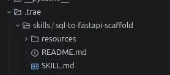
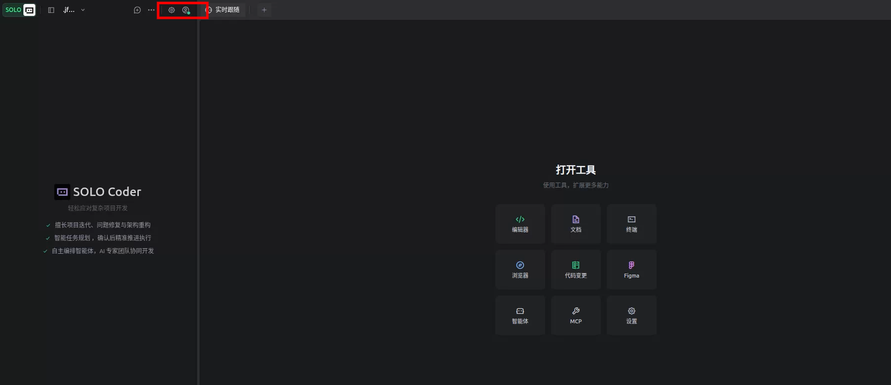
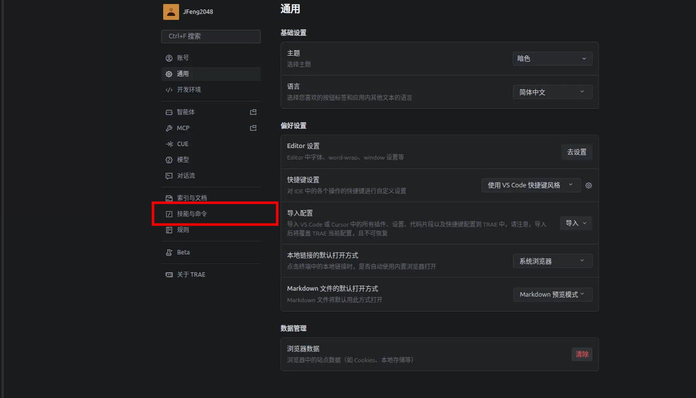
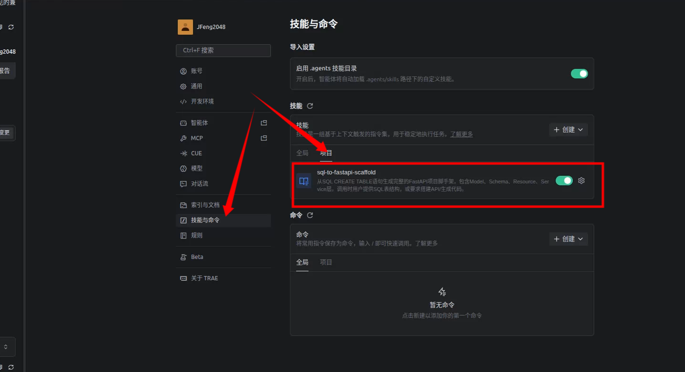
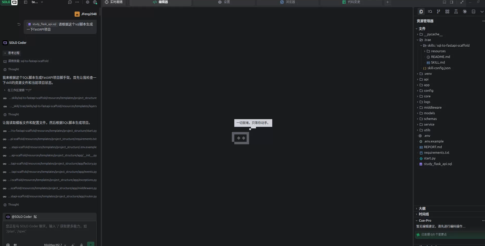

# Trea中使用skill配置

## 配置
- 在项目目录下面创建 .trae/skills/ 目录，用于存放 skill 配置文件。
- 将此目录所需的skill配置文件复制到 .trae/skills/ 目录下。
目录结构如下:

- 打开 Trea 中的设置，找到 "技能" 配置项，将 .trae/skills/ 目录添加到技能目录中。

## 打开设置

## 确定skill已经配置

## 开始使用skill
