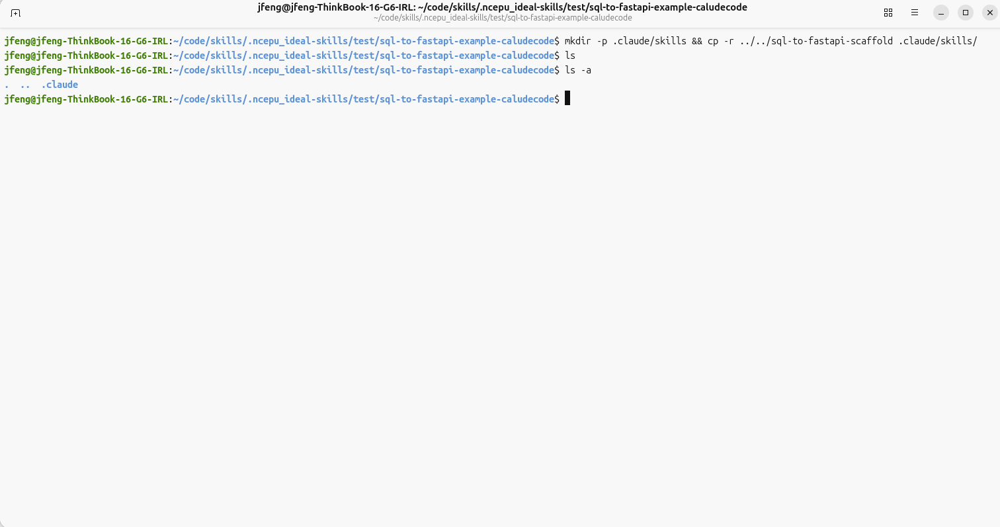
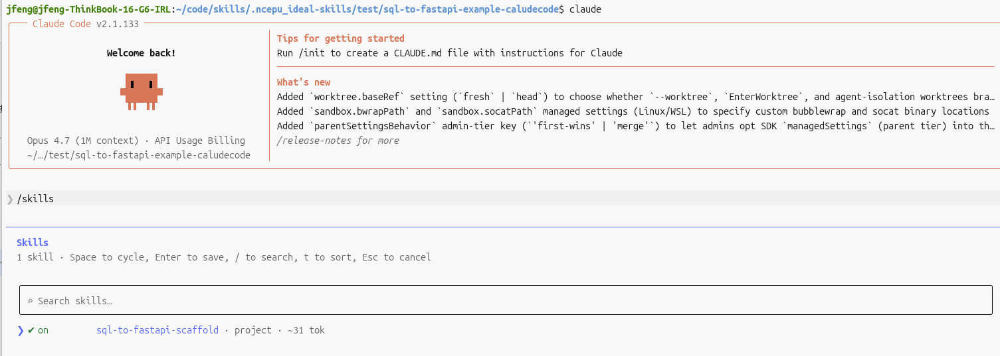
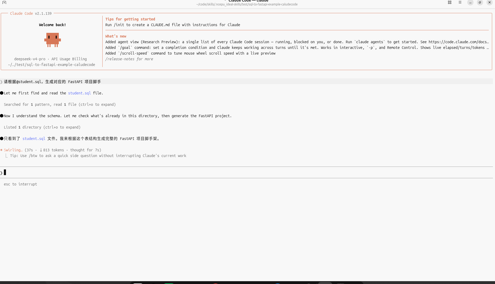

# Claude Code 配置技能指南

## 概述

Claude Code Skills 是一种扩展 Claude 功能的新方式，通过 SKILL.md 文件定义技能的指令、参数和工具权限，使 Claude 能够自动调用相应技能来处理特定任务。

## 技能存放位置

### 全局技能（用户级别）

存放路径：`~/.claude/skills/{skill-name}/`

全局技能对所有项目可用，适合常用的通用技能。

### 项目级技能

存放路径：`{项目根目录}/.claude/skills/{skill-name}/`

项目级技能可随项目一起版本控制，方便团队共享。

### 插件技能

通过 Claude 插件安装的技能会自动可用，无需额外配置。

## 技能目录结构

```
~/.claude/skills/{skill-name}/
├── SKILL.md           # 技能主定义文件（必需）
├── reference.md       # 可选的参考文档
├── examples.md        # 可选的使用示例
└── scripts/           # 可选的辅助脚本目录
    └── helper.py
```

## 技能的自动激活机制

Claude 会根据以下条件自动判断何时使用技能：

1. **文件变化触发**：当检测到相关文件变化时自动激活
2. **关键词匹配**：用户请求中包含 trigger_keywords 时激活
3. **描述匹配**：Claude 根据 description 判断请求是否适合该技能

description 是最重要的触发因素，应该清晰描述技能的适用场景和使用条件。

## 与其他配置机制的区别

| 机制 | 作用域 | 调用方式 | 适用场景 |
|------|--------|----------|----------|
| **Skills** | 全局或项目 | 自动激活 | 扩展 Claude 能力的工具 |
| **Slash Commands** | 全局或项目 | 显式调用（/command） | 常用提示词模板 |
| **CLAUDE.md** | 项目 | 始终加载 | 项目上下文和约定 |

## 使用示例

### sql-to-fastapi-restfulapi-scaffold 技能配置

将此技能复制到 Claude Code 的 skills 目录：

```bash
# 复制技能到全局目录
cp -r sql-to-fastapi-restfulapi-scaffold ~/.claude/skills/
```

技能会自动被 Claude 发现并根据需要激活。当你在对话中提供 SQL CREATE TABLE 语句时，Claude 会自动调用该技能生成 FastAPI 脚手架代码。

### 验证技能已安装

在 Claude Code 中输入 `/skills` 可查看已安装的技能列表。

#### 以下是 配置项目skill的示例图文教程 ：
```bash
mkdir -p .claude/skills && cp -r ../../sql-to-fastapi-restfulapi-scaffold .claude/skills/
```


#### 打开 Claude Code，输入 `/skills` 查看已安装的技能列表。


#### 使用技能 sql-to-fastapi-restfulapi-scaffold 生成 FastAPI 项目脚手架代码。
