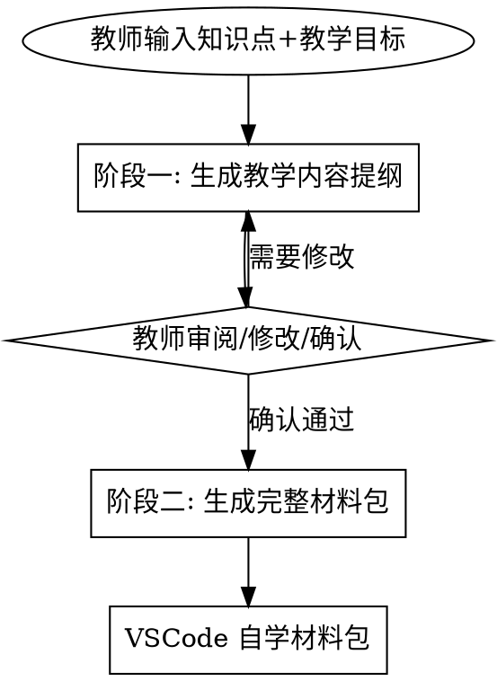

# 备课辅助助手

## 概述

面向计算机专业教师的**两段式**备课技能：先把知识点拆解成「教学内容提纲」交给教师审阅把关；教师确认（或修改）后，再展开成一套**可自学、可实操**的 Markdown 教学材料包——讲义正文 + 配套示例代码 + 配图素材。

四条核心原则：

1. **先提纲、后正文，教师确认是硬门控。** 未经教师明确确认，绝不直接生成全文讲义。
2. **讲什么、举什么例子，都从学生已有的生活经验出发。** 这是全技能第一优先级的内容约束：**所有**开场钩子、类比、示例代码的输入数据、练习场景、配图示意，都必须来自学生亲身经历或已在课内学过的东西（注册账号、购物、聊天、游戏、校园生活、之前学过的 Python 知识）。**禁止**用需要先解释背景才懂的行业业务场景（工单、日志、订单、ERP、运维告警、供应链）当例子——学生要先搞懂场景才能懂知识点，认知负荷花错了地方。选场景前问一句："学生亲眼见过、亲手做过吗？"答不上来就换掉。详见 [`cognitive-sequence-guide.md`](references/cognitive-sequence-guide.md) 的「场景选择」一节。
3. **讲解按认知顺序展开。** 每个知识点都遵循「是什么 → 为什么会出现 → 发展历程 → 应用现状 → 如何开始使用」这条主线；它是**内在叙事顺序**，小节标题要按具体内容自拟（如「一个代词引出的难题」），不要机械地贴五个通用标题。
4. **代码是论证链的一环，来源要诚实标注。** 示例用来"亲眼看看"前面讲的结论（动机 → 简化边界 → 运行 → 输出解读 → 接回原理），不是讲义的附件；引用外部资料、图或未复跑的示例必须写明出处与验证状态。

成品定位是**学生自读的教材**，不是投影用的幻灯片：讲解要充分、语言要通俗（问题开场、第二人称、术语即释）、示例要能跑、关键处要有图解。用 VSCode 打开材料包根目录即可从头到尾自学。上述写作与组织规范来自一套完整教材的实践总结，已内化在本技能的 references 中。

## 何时使用

- 教师给出一个或多个知识点 + 教学目标，需要备课、写讲义、做自学材料
- 需要把已有 PPT 课件或口头讲授内容，改写成学生可自学的图文教程
- 需要为某个技术点准备「带示例代码 + 图解」的实操演示教程
- 需要按统一认知逻辑，批量产出结构一致、风格统一的教学文档

**不适用**：单道习题的答案、纯 PPT 幻灯片生成（用 `ppt/` 分类技能）、论文写作（用 `research/` 技能）、与教学无关的技术问答。

## 两阶段工作流



### 阶段一：生成教学内容提纲

1. **厘清输入。** 从教师处确认：知识点范围、教学目标、学生基础（先修知识）、课时或篇幅预期、偏好的语言/技术栈。信息缺失时先提最关键的问题（不超过 3 个），不要凭空补全。
2. **拆解知识点。** 把范围拆成若干个可独立讲解的知识点，排好先后依赖顺序。
3. **按五段认知逻辑规划每个知识点。** 为每个知识点列出五段各自要讲的核心要点，并为每段**拟定有信息量的小节标题**（问题、现象或关键年份），让提纲读起来就是一部教材的目录。
4. **规划配套资源，并逐项圈定生活场景。** 为每个知识点规划：要配的示例代码（演示什么现象/验证什么结论）、要配的图解（说明什么原理）、要引用的外部资料与图中哪些示例可复跑；**为每个示例和练习写明它用哪个学生熟悉的场景**（如"注册邮箱时的格式校验"而非"工单编号提取"），陌生的行业场景在阶段一就换掉，不要留到阶段二。按知识点数量确定**平铺或分章**布局（见 `workflow-and-structure.md`）。
5. **输出提纲并停下。** 用 [`templates.md`](references/templates.md) 中的「提纲模板」产出，交付后**明确请教师审阅、修改或确认，然后停止本轮工作**。

> 模板、字段说明见 [`workflow-and-structure.md`](references/workflow-and-structure.md) 与 [`templates.md`](references/templates.md)。

### ⛔ 硬门控：等待教师确认

**红线——出现以下任一情况都视为违规，必须停下来重新走门控：**

- 教师还没确认，就生成了正文讲义、示例代码或配图
- 把提纲当作「走个过场」，同一轮里提纲和正文一起输出
- 替教师「默认确认」——教师回复含糊（如"看着办"）时，先把提纲要点复述并请其明确确认
- 只在心里想了想提纲就直接开写

门控解除的**唯一**条件：教师明确表示认可，或给出了具体修改意见且你已按意见更新提纲并再次获得确认。

### 阶段二：生成完整教学材料包

教师确认后，按确认后的提纲逐篇生成：

1. **讲义正文**：每个知识点一个 Markdown 文件，按五段认知逻辑展开但用自拟标题分节；遵循问题开场、第二人称、术语即释、诚实标注四条基调（见 [`cognitive-sequence-guide.md`](references/cognitive-sequence-guide.md)），并对照 [`worked-example.md`](references/worked-example.md) 的范文把握语气与代码咬合方式。
2. **示例代码**：按 [`assets-guide.md`](references/assets-guide.md) 的"动机 → 简化边界 → 运行命令 → 真实输出解读 → 接回原理"四环节写，代码可运行、有注释、有预期输出、有绑定文件与验收条件的练习变体。
3. **配图素材**：原理图/流程图/架构图用 Mermaid 起草后**导出 PNG 并保留 `.mmd` 源码**（不同编辑器内嵌 Mermaid 渲染差异大）；外部图下载到本地并在图注保留原始页面链接；需要形象化场景图时再考虑图像生成工具，详见 [`assets-guide.md`](references/assets-guide.md)。
4. **导航 README**：生成材料包根目录 README（及分章布局的每章 README），含"为什么按这个顺序读 / 全局链路图 / 各节回答什么 / 图与资料清单 / 学完你能 / 快速路径 / 常见卡点"，见 [`workflow-and-structure.md`](references/workflow-and-structure.md)。
5. **练习汇总**：多知识点材料包生成 `exercises/README.md`，含编号清单、统一验收标准与章末综合任务，模板见 [`templates.md`](references/templates.md)。
6. **自检交付**：按文末「常见错误」逐项检查，然后告诉教师材料包位置与打开方式。

## 产物目录结构

材料包生成在**教师当前工作目录或明确指定的位置**（写入前先确认落点），不要写进本技能目录：

按规模选一种布局（在阶段一确定）：

**平铺布局**（少量知识点）：

```text
<课程主题>-教学材料/
├── README.md                 # 总入口：教学设计 + 全局图 + 学习路径 + 清单
├── outline.md                # 已确认的教学内容提纲（存档，便于回溯）
├── notes/                    # 详细讲义正文（一个知识点一个 md）
│   ├── 01-<知识点>.md
│   └── 02-<知识点>.md
├── examples/                 # 配套示例代码（一个示例一个目录）
│   ├── 01-<示例名>/
│   │   ├── README.md         # 示例说明、运行环境、真实输出、输出解读、思考题
│   │   └── main.*            # 可运行代码
│   └── ...
├── exercises/README.md       # 练习汇总：清单 + 验收标准 + 章任务
└── assets/
    ├── diagrams/             # Mermaid 源码 .mmd + 导出的 .png / .svg
    └── images/               # 图像生成工具产出的示意图（可选）
```

**分章布局**（多章节大课程）：

```text
<课程主题>-教学材料/
├── README.md / outline.md
├── 01-<章名>/
│   ├── README.md             # 章导览（八块规范见 workflow-and-structure.md）
│   ├── 01-<知识点>.md        # 讲义与本章资源就近放置，搬一章不散架
│   ├── examples/*.py
│   ├── exercises/README.md
│   └── images/*.png + *.mmd
└── 02-<章名>/
    └── ...
```

讲义中用相对路径引用示例与配图（平铺如 `../examples/01-xxx/main.py`；分章如 `examples/next_token_demo.py`），保证整个目录拷走后链接仍有效。

## 内容风格要求

写的是**自读教材**，不是幻灯片。具体标准：

| 维度 | 要做到 | 要避免 |
| --- | --- | --- |
| 信息密度 | 充分展开，讲透来龙去脉 | 只剩要点短语、提纲挈领 |
| 开篇 | 用**学生亲身经历**的生活场景或问题起头，再引出概念（"注册邮箱时系统怎么知道你瞎填"） | 用陌生行业场景起头（"工单备注里有两个编号"）；一上来抛形式化定义 |
| 例子与场景 | 全篇每个例子、类比、示例输入、练习都来自学生生活或课内已学内容；学生不需要额外背景就能懂 | 用行业业务流程举例；例子本身还要先解释"这是啥" |
| 语言 | 全程第二人称，打比方、生活类比；术语首次出现括号里给全称+中文+大白话 | 堆术语、定义套定义、写"读者将会" |
| 连贯性 | 段落间有过渡，前有铺垫后有小结，结尾预告下一节 | 一节节孤立罗列 |
| 可操作性 | 代码有"动机→简化边界→运行命令→真实输出解读→接回原理"四环节；练习绑定文件给验收条件 | 只描述"可以用某某实现"，或甩个代码就过 |
| 可读性 | 适度留白、图示辅助、关键处加粗、复杂规则用一句话提炼 | 大段文字墙、满篇列表 |
| 认知引导 | 先建立直觉再给定义，先提出问题再给答案 | 一上来就抛形式化定义 |
| 诚实性 | 外部资料/图标出处；未复跑示例写明验证状态；示意数值与代码输出不符要说明 | 把引用伪装成自己验证过、编造精确年份 |

## 配图与素材策略

- **原理图 / 流程图 / 架构图 / 时序图**：用 Mermaid 起草，**导出 PNG 并保留同名 `.mmd` 源码**放 `assets/diagrams/`（或章 `images/`），讲义用图片语法引用。不同编辑器内嵌 Mermaid 渲染差异大，旧版本会渲染成空白框，故不再推荐直接内嵌。
- **外部教程 / 论文的图**：下载到本地，讲义用相对路径引用（断网可看），图注保留原始页面链接，并在 README 维护图清单。
- **需要精细排版的示意图**：生成 `.svg` 放 `assets/diagrams/`，讲义中用图片语法引用。
- **需要形象生动的场景图 / 概念插画**：若当前环境提供图像生成工具，生成 PNG 放 `assets/images/`；若环境不提供，改用 Mermaid 或 SVG 表达，**不要因此中断任务或留下空占位**。
- 每张图都要有图题和**一段**文字解读（点出关键符号、与本节的关系、该看哪里）；示意数值与代码实际输出不一致时明确说明。

## 快速参考

| 阶段 | 输入 | 产物 | 是否可跳过 |
| --- | --- | --- | --- |
| 一 | 知识点 + 教学目标（+ 学生基础等） | `outline.md` 教学内容提纲 | 否，必经 |
| 门控 | 教师确认 / 修改意见 | 更新后的提纲 | 否，硬门控 |
| 二 | 已确认提纲 | 讲义 md + 示例代码 + 配图 + README | 否 |

## 常见错误

| 错误 | 后果 | 修复 |
| --- | --- | --- |
| 跳过提纲直接写全文 | 方向错了要全部返工 | 严格执行两阶段，确认前停手 |
| 用陌生行业场景举例（工单、日志、订单、运维告警） | 学生要先懂场景才能懂知识点，认知负荷花错地方 | 换成学生亲身经历的生活场景；选场景前问"学生亲眼见过吗" |
| 提纲没写清每个例子用什么场景 | 阶段二容易随手挑业务场景，整篇例子都跑偏 | 阶段一为每个示例与练习标注生活场景，阶段二照此写 |
| 讲解写成 PPT 式要点罗列 | 学生看不懂、无法自学 | 按五段逻辑展开，补充铺垫、类比、过渡 |
| 五段当标题硬贴（"一、是什么…"） | 千篇一律，读起来像模板 | 五段内化为叙事，小节标题按内容自拟 |
| 认知顺序错乱（如先讲应用再讲是什么） | 学生建立不起直觉 | 每段严格按五段顺序写 |
| 代码与讲解脱节：甩个代码块就过 | 学生跑完不知证明了什么 | 代码写全"动机→简化边界→运行→输出解读→接回原理"四环节 |
| 练习写成"试试改一改" | 无法自测是否掌握 | 练习绑定具体文件 + 给验收条件，分基础/进阶/挑战 |
| 示例代码不可运行 / 输出杜撰 | 学生实操受挫 | 代码跑通并记录真实输出；未复跑的写明验证状态 |
| 外部图 / 引用不标出处，示意数值不说明 | 学生误把示意当事实 | 图注保留原始链接，示意数值与代码输出不符要明确说明 |
| 配图无文字解读 / 直接内嵌 Mermaid | 图成摆设或渲染成空白框 | 每图配图题+一段解读；Mermaid 导出 PNG 并保留 `.mmd` |
| 素材写进技能目录或路径写死 | 材料包拷走后链接失效 | 生成在教师工作目录，用相对路径引用 |

## 参考文件索引

- [`workflow-and-structure.md`](references/workflow-and-structure.md) — 两阶段流程细节、输入澄清清单、平铺/分章布局、导航 README 八块规范
- [`cognitive-sequence-guide.md`](references/cognitive-sequence-guide.md) — 五段认知逻辑逐段写法 + 四条基调 + 12 项写作技巧 + 分层路径
- [`templates.md`](references/templates.md) — 提纲、讲义正文、示例说明、练习汇总四套模板
- [`assets-guide.md`](references/assets-guide.md) — 代码四环节与练习验收、配图导出与来源标注规范
- [`worked-example.md`](references/worked-example.md) — 完整讲义节选范文：四条基调、代码四环节、验收条件与来源标注的落地形态，生成时作为具体参照
