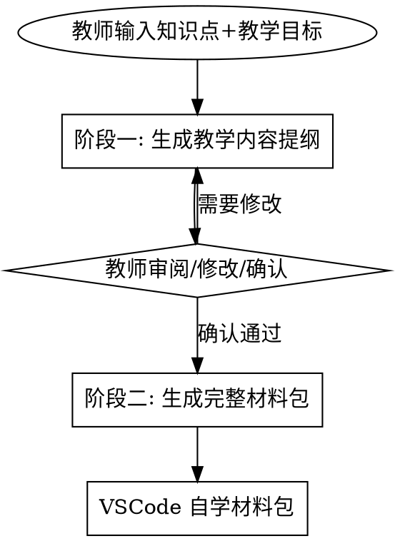

# 备课辅助助手

## 概述

面向计算机专业教师的**两段式**备课技能：先把知识点拆解成「教学内容提纲」交给教师审阅把关；教师确认（或修改）后，再展开成一套**可自学、可实操**的 Markdown 教学材料包——讲义正文 + 配套示例代码 + 配图素材。

两条核心原则：

1. **先提纲、后正文，教师确认是硬门控。** 未经教师明确确认，绝不直接生成全文讲义。
2. **讲解按认知顺序展开。** 每个知识点都遵循「是什么 → 为什么会出现 → 发展历程 → 应用现状 → 如何开始使用」这条主线。

成品定位是**学生自读的教材**，不是投影用的幻灯片：讲解要充分、语言要通俗、示例要能跑、关键处要有图解。用 VSCode 打开材料包根目录即可从头到尾自学。

## 何时使用

- 教师给出一个或多个知识点 + 教学目标，需要备课、写讲义、做自学材料
- 需要把已有 PPT 课件或口头讲授内容，改写成学生可自学的图文教程
- 需要为某个技术点准备「带示例代码 + 图解」的实操演示教程
- 需要按统一认知逻辑，批量产出结构一致、风格统一的教学文档

**不适用**：单道习题的答案、纯 PPT 幻灯片生成（用 `ppt/` 分类技能）、论文写作（用 `research/` 技能）、与教学无关的技术问答。

## 两阶段工作流



### 阶段一：生成教学内容提纲

1. **厘清输入。** 从教师处确认：知识点范围、教学目标、学生基础（先修知识）、课时或篇幅预期、偏好的语言/技术栈。信息缺失时先提最关键的问题（不超过 3 个），不要凭空补全。
2. **拆解知识点。** 把范围拆成若干个可独立讲解的知识点，排好先后依赖顺序。
3. **按五段认知逻辑规划每个知识点。** 为每个知识点列出「是什么 / 为什么会出现 / 发展历程 / 应用现状 / 如何开始使用」五段各自要讲的核心要点。
4. **规划配套资源。** 为每个知识点规划：要配的示例代码（解决什么问题）、要配的图解（说明什么原理）。
5. **输出提纲并停下。** 用 [`templates.md`](references/templates.md) 中的「提纲模板」产出，交付后**明确请教师审阅、修改或确认，然后停止本轮工作**。

> 模板、字段说明见 [`workflow-and-structure.md`](references/workflow-and-structure.md) 与 [`templates.md`](references/templates.md)。

### ⛔ 硬门控：等待教师确认

**红线——出现以下任一情况都视为违规，必须停下来重新走门控：**

- 教师还没确认，就生成了正文讲义、示例代码或配图
- 把提纲当作「走个过场」，同一轮里提纲和正文一起输出
- 替教师「默认确认」——教师回复含糊（如"看着办"）时，先把提纲要点复述并请其明确确认
- 只在心里想了想提纲就直接开写

门控解除的**唯一**条件：教师明确表示认可，或给出了具体修改意见且你已按意见更新提纲并再次获得确认。

### 阶段二：生成完整教学材料包

教师确认后，按确认后的提纲逐篇生成：

1. **讲义正文**：每个知识点一个 Markdown 文件，严格按五段认知逻辑展开，遵循生动通俗的写作要求（见 [`cognitive-sequence-guide.md`](references/cognitive-sequence-guide.md)）。
2. **示例代码**：按 [`assets-guide.md`](references/assets-guide.md) 组织，代码可运行、有注释、有预期输出、有练习变体。
3. **配图素材**：原理图/流程图/架构图优先用 Mermaid（自包含、VSCode 可渲染）；需要形象化场景图时再考虑图像生成工具，详见 [`assets-guide.md`](references/assets-guide.md)。
4. **导航 README**：生成材料包根目录的 `README.md`，含学习路径与文件清单，见 [`workflow-and-structure.md`](references/workflow-and-structure.md)。
5. **自检交付**：按文末「常见错误」逐项检查，然后告诉教师材料包位置与打开方式。

## 产物目录结构

材料包生成在**教师当前工作目录或明确指定的位置**（写入前先确认落点），不要写进本技能目录：

```text
<课程主题>-教学材料/
├── README.md                 # 总入口：学习路径 + 文件清单 + 使用方法
├── outline.md                # 已确认的教学内容提纲（存档，便于回溯）
├── notes/                    # 详细讲义正文（一个知识点一个 md）
│   ├── 01-<知识点>.md
│   └── 02-<知识点>.md
├── examples/                 # 配套示例代码（一个示例一个目录）
│   ├── 01-<示例名>/
│   │   ├── README.md         # 示例说明、运行环境、预期输出、思考题
│   │   └── main.*            # 可运行代码
│   └── ...
└── assets/                   # 配图与素材
    ├── diagrams/             # Mermaid 源码 / SVG 图
    └── images/               # 图像生成工具产出的示意图（可选）
```

讲义中用相对路径引用示例与配图（如 `../examples/01-xxx/main.py`、`../assets/diagrams/xxx.md`），保证整个目录拷走后链接仍有效。

## 内容风格要求

写的是**自读教材**，不是幻灯片。具体标准：

| 维度 | 要做到 | 要避免 |
| --- | --- | --- |
| 信息密度 | 充分展开，讲透来龙去脉 | 只剩要点短语、提纲挈领 |
| 语言 | 口语化、打比方、生活类比 | 堆术语、定义套定义 |
| 连贯性 | 段落间有过渡，前有铺垫后有小结 | 一节节孤立罗列 |
| 可操作性 | 给可跑的代码和可复现的步骤 | 只描述"可以用某某实现" |
| 可读性 | 适度留白、图示辅助、关键处加粗 | 大段文字墙、满篇列表 |
| 认知引导 | 先建立直觉再给定义，先提出问题再给答案 | 一上来就抛形式化定义 |

## 配图与素材策略

- **原理图 / 流程图 / 架构图 / 时序图**：优先写 Mermaid 代码块，直接嵌在讲义里（VSCode 安装 Mermaid 预览插件即可渲染），自包含、可修改。
- **需要精细排版的示意图**：生成 `.svg` 文件放 `assets/diagrams/`，讲义中用图片语法引用。
- **需要形象生动的场景图 / 概念插画**：若当前环境提供图像生成工具，生成 PNG 放 `assets/images/`；若环境不提供，改用 Mermaid 或 SVG 表达，**不要因此中断任务或留下空占位**。
- 每张图都要有图题和一句「这张图说明了什么」的文字解读，不能只贴图。

## 快速参考

| 阶段 | 输入 | 产物 | 是否可跳过 |
| --- | --- | --- | --- |
| 一 | 知识点 + 教学目标（+ 学生基础等） | `outline.md` 教学内容提纲 | 否，必经 |
| 门控 | 教师确认 / 修改意见 | 更新后的提纲 | 否，硬门控 |
| 二 | 已确认提纲 | 讲义 md + 示例代码 + 配图 + README | 否 |

## 常见错误

| 错误 | 后果 | 修复 |
| --- | --- | --- |
| 跳过提纲直接写全文 | 方向错了要全部返工 | 严格执行两阶段，确认前停手 |
| 讲解写成 PPT 式要点罗列 | 学生看不懂、无法自学 | 按五段逻辑展开，补充铺垫、类比、过渡 |
| 认知顺序错乱（如先讲应用再讲是什么） | 学生建立不起直觉 | 每段严格按五段顺序写 |
| 示例代码不可运行 / 无输出说明 | 学生实操受挫 | 代码跑通并记录预期输出与依赖 |
| 配图无文字解读 | 图成了摆设 | 每图配图题 + 一句话说明 |
| 素材写进技能目录或路径写死 | 材料包拷走后链接失效 | 生成在教师工作目录，用相对路径引用 |

## 参考文件索引

- [`workflow-and-structure.md`](references/workflow-and-structure.md) — 两阶段流程细节、输入澄清清单、产物目录与导航 README 规范
- [`cognitive-sequence-guide.md`](references/cognitive-sequence-guide.md) — 五段认知逻辑逐段写法 + 生动通俗写作技巧
- [`templates.md`](references/templates.md) — 提纲模板、讲义正文模板、示例说明模板
- [`assets-guide.md`](references/assets-guide.md) — 示例代码与配图素材的组织、生成与引用规范
