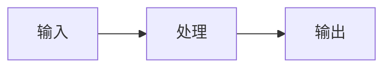
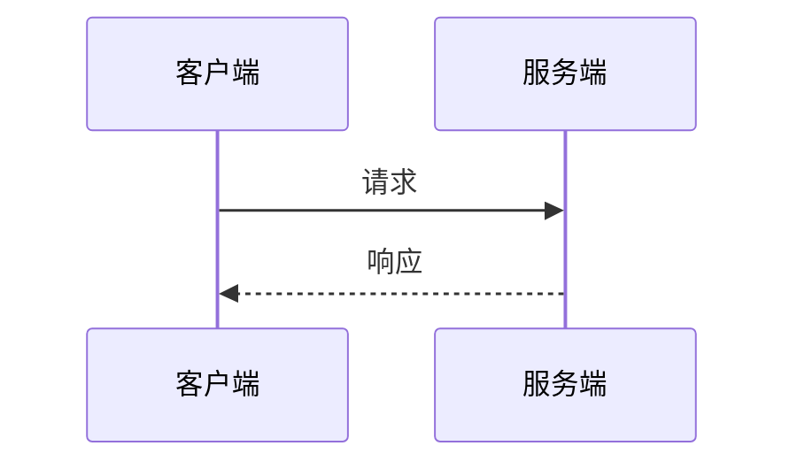

# 示例代码与配图素材规范

本文件有两个关键目标：让示例代码成为**论证链的一环**（而不是讲义的附件），以及让配图在不同编辑器里都**真的显示得出来**。

## 第一部分：示例代码

### 场景先于代码

选示例之前，先按 `cognitive-sequence-guide.md`「场景选择」定场景：**示例里的输入数据、练习里的业务背景，都必须是学生亲身经历过的东西**——注册邮箱、手机号、用户名、聊天消息、成绩单、游戏数值；不要用工单编号、订单流水、日志行这类需要行业背景的数据。

场景不贴近，代码写得再漂亮也白搭：学生要先花力气理解例子本身，反而没余力看知识点。发现示例依赖陌生场景时，换场景重写，不要在代码注释里补一段"什么是工单"的解释。

### 代码与讲义的联动（最重要）

一条经过完整教材验证的经验是：**代码不是写完讲义后挂上去的资源，而是讲解推进到某一步时用来"亲眼看看"的证据**。一条完整的代码叙事有四个环节，缺一不可：

| 环节 | 要在讲义里写什么 |
| --- | --- |
| 1. 先给动机 | "理解了原理，就能写一个极小的版本。下面这个程序只学一件事：……" |
| 2. 声明简化边界 | "它比真实模型简陋得多——真实模型看整段上下文，它只看前一个字——但足以让你亲眼看到……" |
| 3. 给运行命令 + 真实输出 | 紧跟代码块给出 `python examples/...` 命令，再用文字解读输出："你会看到两件事：一是……，二是……。原因很直白：……" |
| 4. 把结论接回原理 | "这也顺带解释了为什么需要注意力：如果每个字都能回头看整句……" |

> 反面模式：讲义讲完原理，甩一个代码块，然后直接进入下一节。学生跑完不知道证明了什么，代码就成了摆设。

**讲解与代码是同一条主线的两个版本**：讲义里放最短的可运行片段（能说明问题即可），`examples/` 里放完整版与练习。讲义用相对链接指向完整示例，示例 README 回链讲义。

### 目录约定

示例按规模选一种布局：

```text
# 单篇/少量知识点：平铺
examples/
├── 01-快速排序/
│   ├── README.md      # 示例说明（用 templates.md 模板三）
│   └── main.py        # 可运行代码
└── 02-复杂度对比/
    ├── README.md
    ├── main.py
    └── requirements.txt   # 仅在有第三方依赖时提供

# 多章节大课程：每章自带 examples/（见 workflow-and-structure.md）
01-llm-fundamentals/
├── 02-how-llm-works.md
├── examples/next_token_demo.py
├── exercises/README.md
└── images/
```

- 一个示例一个目录（平铺式）或一章一个 `examples/`（分章式）；编号与讲义序号对应。
- 主文件统一命名 `main.<ext>` 或用语义名（`next_token_demo.py`）；学生不需要猜入口。
- 依赖较多时提供 `requirements.txt` / `pom.xml` 等，并在 README 写明版本；**可选依赖明确标注"装不上就跳过，不影响后续章节"**。

### 代码质量要求

| 要求 | 说明 |
| --- | --- |
| 可运行 | 生成后实际跑一遍（环境允许时），确认无语法/依赖错误 |
| 场景贴近生活 | 输入数据用学生见过的东西（邮箱、手机号、聊天内容），不用凭空设定的业务编号；练习背景同理 |
| 输出可预期 | README 与讲义记录**真实**运行输出，学生可对照检查 |
| 诚实标注验证状态 | 未独立复跑的示例（如引自外部）要写明"引自 XX，本环境未复跑"，不要伪装成自己验证过 |
| 自包含 | 尽量一个文件跑通；确需多文件时在 README 说明，并给出从项目根目录运行的命令 |
| 注释到位 | 关键算法/易错点写中文注释，解释"为什么"而非复述代码 |
| 难度递进 | 先最小示例，再递进任务，避免一上来就是完整复杂系统 |
| 简化边界明确 | 教学用极简示例要在代码开头 docstring 和讲义里都写明"它省略了什么" |

### 练习要绑定文件与验收条件

讲义末尾的"动手练习"不要写成泛泛的"试试改一改"，每条练习都要：

1. **绑定具体文件**：`把 examples/01-xxx/main.py 里的 CORPUS 加一句……，重跑它`；
2. **给出验收条件**：`验收条件：能解释为什么候选表里多了一个「门」`；
3. **分基础 / 进阶 / 挑战三档**，挑战题可选。

多知识点课程另建 `exercises/README.md` 汇总（模板见 `templates.md` 模板四）：编号、对应小节、类型、任务摘要、是否需要 API、统一验收标准、章末综合任务。

## 第二部分：配图素材

### 选择决策

| 要表达的内容 | 首选方案 | 存放位置 | 讲义中的形式 |
| --- | --- | --- | --- |
| 流程图、架构图、时序图、状态机 | Mermaid 源码 + **导出 PNG** | `assets/diagrams/*.mmd` 与 `*.png` 并存 | `` |
| 时间线 | Mermaid `timeline` + PNG | 同上 | 图片引用 |
| 需要精细排版/美术加工的结构图 | SVG | `assets/diagrams/*.svg` | `` |
| 形象化场景图、概念插画、拟物类比图 | 图像生成工具产出 PNG | `assets/images/*.png` | `` |
| 数据图表 | 代码生成 SVG/PNG，或 Mermaid | `assets/` 对应子目录 | 图片引用 |

### 为什么不再"直接内嵌 Mermaid"

早期规范建议把 `mermaid` 代码块直接写进讲义，但实践发现：**不同编辑器、不同版本内嵌的 Mermaid 渲染差异大，旧版本会把不支持的写法渲染成空白框**。因此改为：

1. 先在讲义里用 Mermaid 代码块起草图；
2. 导出为 PNG 存入 `assets/diagrams/`；
3. 同名 `.mmd` 源码放在旁边，要改图就改源码再重新导出；
4. 讲义正文用 `` 引用图片。

这样自包含、跨编辑器稳定、且仍可修改。只有在确认目标环境支持且图很简单时，才保留内嵌 Mermaid 代码块作为补充。

常用图型（起草时用）：





### 外部图的本地化

引用外部教程 / 论文的图时：

1. **下载到本地** `images/` 或 `assets/diagrams/`，正文用相对路径引用，断网也能看；
2. 图注里保留**原始页面链接**，方便核对原图与确认最新版本；
3. 维护一张"图清单"表（图号 / 文件 / 出现位置 / 讲什么 / 原始页面），放在章 README 或材料包 README；
4. 说明格式兼容性：如 `.webp` 在部分 PDF / Word 导出工具里不认，提示读者另存为 `.png` 并改引用路径。

### 图像生成工具的使用

当环境提供图像生成工具（如 ImageGen）且确实需要形象化插画时：

1. 用于"是什么"段的生活类比图景、"应用现状"段的场景示意等形象化内容。
2. 提示词写清：面向计算机专业学生、教学示意图、风格清晰、标注中文（如工具支持）。
3. 生成后存入 `assets/images/`，讲义中用相对路径引用，并配图题与一句话解读。
4. **环境不提供图像生成工具时**：不是阻断理由。改用 Mermaid 导出 PNG 或手写 SVG 表达同一概念，继续完成任务，不留下空占位或"图略"。

### 配图必备要素

每张图都要有：

1. **图题**：一句话命名，如「图 1 TCP 三次握手时序」。
2. **文字解读**：紧跟图后**一段**解读——不只说"这张图说明了什么"，还要点出图里关键符号的含义、与本节的关联、读者应重点关注哪部分。例如"注意后面用的 GPT 只保留了右半边，所以读这张图时不必记全，认出骨架即可"，这种"教你怎么看图"的解读远胜于一句标签。
3. **来源与示意声明**：外部图写清出处；图上数值与示例代码实际输出不一致时，明确写"图上数字仅为示意，想自己算一遍用 `examples/xxx.py`"。
4. **相对路径引用**：``，保证目录整体拷走后有效。

### 素材文件命名

- 小写字母 + 连字符（或示例风格的"图号-主题"），编号前缀与讲义对应：`01-handshake-sequence.mmd`、`02-how-llm-works-fig1.png`
- 中文可读性由图题提供，文件名保持 ASCII 便于跨平台
- 导出的 PNG 与 `.mmd` 源码同名，方便对照修改

## 自检清单

- [ ] 示例代码的输入数据与练习场景都来自学生生活，没有需要先解释背景的行业场景
- [ ] 示例代码全部可运行，讲义与 README 记录的是真实预期输出
- [ ] 每段代码都有"动机 → 简化边界 → 运行命令 → 输出解读 → 接回原理"四环节
- [ ] 练习绑定具体文件并给出验收条件，分基础/进阶/ Challenge 三档
- [ ] 未独立复跑的示例与外部资料都标了来源与验证状态
- [ ] 讲义与示例双向链接，均为相对路径
- [ ] 关键流程/架构有图，Mermaid 已导出 PNG 并保留 `.mmd` 源码，跨编辑器可显示
- [ ] 每张图有图题、一段文字解读、来源与示意声明
- [ ] 外部图已本地化并在图清单中登记原始页面
- [ ] 配图素材放在 `assets/` 或章 `images/` 对应子目录，未写进技能目录
- [ ] 图像生成工具不可用时，已用 Mermaid/SVG 替代，无空占位
