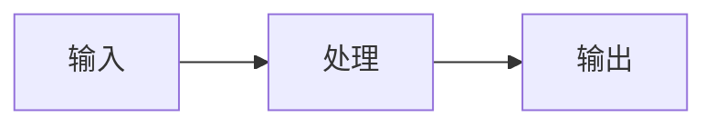
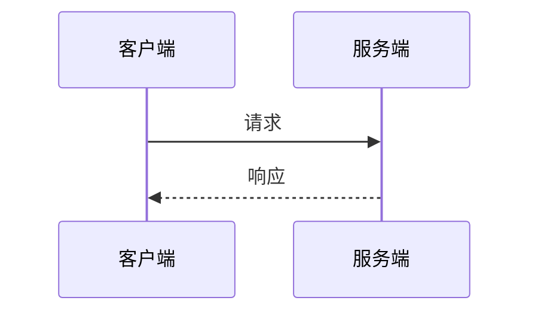

# 示例代码与配图素材规范

## 示例代码组织

### 目录约定

```text
examples/
├── 01-快速排序/
│   ├── README.md      # 示例说明（用 templates.md 模板三）
│   └── main.py        # 可运行代码
└── 02-复杂度对比/
    ├── README.md
    ├── main.py
    └── requirements.txt   # 仅在有第三方依赖时提供
```

- 一个示例一个目录，编号与讲义序号对应（`01-` 对应 `notes/01-*.md`）。
- 主文件统一命名 `main.<ext>`，学生不需要猜入口。
- 依赖较多时提供 `requirements.txt` / `pom.xml` 等，并在 README 写明版本。

### 代码质量要求

| 要求 | 说明 |
| --- | --- |
| 可运行 | 生成后实际跑一遍（环境允许时），确认无语法/依赖错误 |
| 自包含 | 尽量一个文件跑通，避免跨文件跳转；确需多文件时在 README 说明 |
| 注释到位 | 关键算法/易错点写中文注释，解释"为什么"而非复述代码 |
| 输出可预期 | README 记录真实运行输出，学生可对照检查 |
| 难度递进 | 先最小示例，再递进任务，避免一上来就是完整复杂系统 |
| 有练习 | 每示例留 1～3 个动手试一试的变体任务 |

### 代码与讲义的联动

- 讲义「如何开始使用」段中的最小示例，和 `examples/` 里的完整示例应是**同一条主线**：讲义给精简版，示例目录给完整版与练习。
- 讲义中用相对链接指向示例：`[完整示例](../examples/01-xxx/README.md)`。
- 示例 README 中回链讲义：`[回到讲义](../notes/01-xxx.md)`。

## 配图素材策略

### 选择决策

| 要表达的内容 | 首选方案 | 存放位置 | 讲义中的形式 |
| --- | --- | --- | --- |
| 流程图、架构图、时序图、状态机 | Mermaid 代码块 | 直接内嵌讲义，源码另存 `assets/diagrams/*.mmd` | ```mermaid 代码块 |
| 时间线 | Mermaid `timeline` | 同上 | ```mermaid 代码块 |
| 需要精细排版/美术加工的结构图 | SVG | `assets/diagrams/*.svg` | `` |
| 形象化场景图、概念插画、拟物类比图 | 图像生成工具产出 PNG | `assets/images/*.png` | `` |
| 数据图表 | 代码生成 SVG/PNG，或 Mermaid | `assets/` 对应子目录 | 图片引用 |

### Mermaid 优先原则

原理图/流程图/架构图/时序图**优先用 Mermaid**，原因：

1. 纯文本、自包含，整个材料包拷走后不丢图
2. 学生可直接改源码看变化，利于学习
3. VSCode 安装 `Markdown Preview Mermaid Support` 插件即可渲染

常用图型：





### 图像生成工具的使用

当环境提供图像生成工具（如 ImageGen）且确实需要形象化插画时：

1. 用于「是什么」段的生活类比图景、「应用现状」段的场景示意等形象化内容。
2. 提示词写清：面向计算机专业学生、教学示意图、风格清晰、标注中文（如工具支持）。
3. 生成后存入 `assets/images/`，讲义中用相对路径引用，并配图题与一句话解读。
4. **环境不提供图像生成工具时**：不是阻断理由。改用 Mermaid 流程图或手写 SVG 表达同一概念，继续完成任务，不留下空占位或"图略"。

### 配图必备要素

每张图都要有：

1. **图题**：一句话命名，如「图 1 TCP 三次握手时序」。
2. **文字解读**：紧跟图后一句"这张图说明了……"，点出学生应关注的部分。
3. **相对路径引用**：``，保证目录整体拷走后有效。

### 素材文件命名

- 小写字母 + 连字符，编号前缀与讲义对应：`01-handshake-sequence.mmd`、`02-architecture.svg`
- 中文可读性由图题提供，文件名保持 ASCII 便于跨平台

## 自检清单

- [ ] 示例代码全部可运行，README 有真实预期输出
- [ ] 讲义与示例双向链接，均为相对路径
- [ ] 关键流程/架构有 Mermaid 图，且图中文字可读
- [ ] 每张图有图题和一句话解读
- [ ] 配图素材放在 `assets/` 对应子目录，未写进技能目录
- [ ] 图像生成工具不可用时，已用 Mermaid/SVG 替代，无空占位
