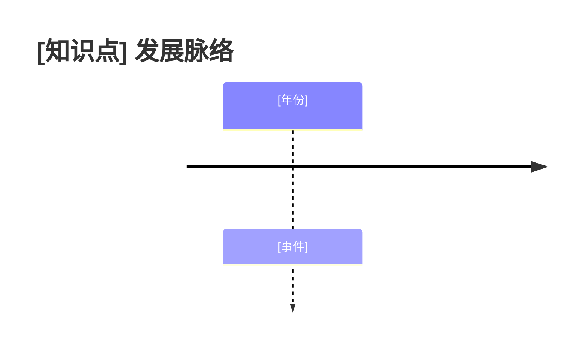

# 产物模板

本文件提供三套模板：教学内容提纲（阶段一产物）、讲义正文（阶段二核心产物）、示例说明 README。方括号 `[...]` 为占位说明，生成时替换为实际内容并删除方括号。

---

## 模板一：教学内容提纲（outline.md）

```markdown
# [课程/主题名称] 教学内容提纲

## 基本信息

- 教学对象：[如 计算机专业本科二年级]
- 教学目标：[学完本节后学生能够……]
- 知识点范围：[覆盖哪几个知识点]
- 先修要求：[学生需要先掌握……]
- 篇幅预期：[共 N 篇讲义，每篇约 X 字]
- 讲解语言 / 技术栈：[中文 / Python 3.x]
- 本提纲假设：[对教师未明确、由你合理默认的事项逐条列出，供教师校正]

## 教学设计与顺序

[一句话说明为什么按这个顺序安排知识点，依赖关系是什么。]

## 知识点清单

### 知识点 1：[名称]

- 先修：[需要学生先懂什么]
- 教学目标：[本篇学完要达到的具体能力]

| 认知阶段 | 本段要点 |
| --- | --- |
| 是什么 | [直觉定义 + 具体例子] |
| 为什么会出现 | [当时的痛点 1～2 条] |
| 发展历程 | [3～5 个关键节点] |
| 应用现状 | [应用场景 + 局限] |
| 如何开始使用 | [环境/最小示例/递进任务] |

- 配套示例：[示例名] —— [演示什么现象/验证什么结论]
- 配套配图：[图名] —— [说明什么原理/流程]

### 知识点 2：[名称]

[同上结构，按实际知识点数量复制]

## 配套资源规划

| 类型 | 名称 | 服务于哪个知识点 | 说明 |
| --- | --- | --- | --- |
| 示例代码 | [01-xxx] | [知识点 1] | [演示……] |
| 配图 | [xxx 原理图] | [知识点 1] | [说明……] |

## 请教师确认

1. 知识点拆解与顺序是否符合预期？
2. 各知识点的五段要点是否需要增删或调整侧重？
3. 先修、篇幅、技术栈等假设是否需要修正？

请确认或修改后告知，我再生成完整材料包。
```

---

## 模板二：讲义正文（notes/NN-<知识点>.md）

```markdown
# [序号] [知识点名称]

> 一句话导语：这篇讲什么，学完能做什么。[约 X 分钟]

## 一、是什么

[直觉定义 + 生活类比 + 具体场景 + 规范定义 + 上下游位置关系]

## 二、为什么会出现

[当时的困境 → 具体痛点 → 过渡句]

## 三、发展历程

[时间脉络 3～5 个节点：谁/何时/解决什么/留下什么问题]



[时间线图的一句话解读]

## 四、应用现状

[3～5 个真实应用场景，每个说明承担的角色 + 主流工具落地 + 局限与替代方案]

## 五、如何开始使用

### 环境准备

[依赖 + 安装命令]

### 第一个例子

[最短可运行代码]

> 预期输出：[运行后应该看到什么]

[常见报错及原因 1～2 条]

### 再进一步

[2～3 个递进小任务]

完整示例见 [`../examples/[NN-示例名]/README.md`](../examples/[NN-示例名]/README.md)。

## 小结

[一段话收束，提炼核心]

## 思考题

1. [自测题]
2. [自测题]
```

> 说明：不是每个知识点都必须配时间线图，但「发展历程」一段建议至少有一张图；若知识点历史简单，可用普通段落代替。配图引用统一放 `assets/diagrams/`，见 [`assets-guide.md`](assets-guide.md)。

---

## 模板三：示例说明 README（examples/NN-<示例名>/README.md）

```markdown
# 示例 NN：[示例名称]

## 演示目标

[这段代码验证/展示什么结论，服务于哪篇讲义的哪一段。关联：[讲义链接]]

## 运行环境

- 语言/版本：[如 Python 3.10+]
- 依赖：[如 `pip install numpy`；无依赖则写"仅标准库"]

## 运行方式

```bash
python main.py
```

## 预期输出

```text
[粘贴真实运行输出，不要杜撰]
```

## 代码导读

- [关键行/函数 1]：[作用]
- [关键行/函数 2]：[作用]

## 动手试一试

1. 把 [某参数] 改成 [某值]，观察 [什么变化]。
2. 尝试 [变体任务]。

## 常见坑

| 现象 | 原因 | 解决 |
| --- | --- | --- |
| [报错/异常] | [原因] | [解决] |
```

## 模板使用约定

- 生成时把所有 `[...]` 占位替换为真实内容，删除未使用的段落与方括号。
- 代码块语言标签要写具体（`python`、`bash`、`java`、`text`），便于 VSCode 高亮。
- 讲义与示例 README 中引用其他文件时，一律使用相对路径。
- 模板是骨架不是枷锁：内容需要时可以增删小节，但五段认知顺序不能变。
